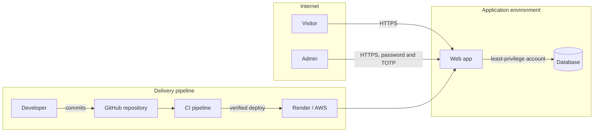

# Threat model

This document describes what the site needs to protect, where an
attacker could get in, and which controls stand in the way. Control IDs
(ZT-xx) refer to `requirements.md`. I review this model at the end of
each sprint and whenever the architecture changes.

## What needs protecting
- Admin credentials and sessions
- Contact messages, which contain visitors' personal data
- The integrity of the site's content and of the code that produces it
- Credentials used by the pipeline and the cloud accounts
- The domain, which controls where the site and its email point

## Trust boundaries
Nothing is trusted because of where it sits. Still, three zones have
different exposure:

- **Internet**: anonymous visitors, the admin, and attackers
- **Application environment**: the web app and its database
- **Delivery pipeline**: the repository, CI and the hosting platforms

## Threats and controls
Categories follow STRIDE: Spoofing, Tampering, Repudiation, Information
disclosure, Denial of service, Elevation of privilege.

| ID | Category | Threat | Controls |
|----|----------|--------|----------|
| T-01 | Spoofing | Someone guesses or steals the admin password | ZT-01, ZT-02, ZT-05 |
| T-02 | Spoofing | The domain is hijacked or a certificate is issued by someone else | ZT-19, ZT-17 |
| T-03 | Tampering | Script or SQL injected through the contact form | ZT-04, ZT-09, ZT-17 |
| T-04 | Tampering | A vulnerable or malicious dependency enters the build | ZT-16, ZT-06 |
| T-05 | Tampering | Stolen pipeline or cloud credentials are used to ship changes | ZT-06, ZT-10 |
| T-06 | Repudiation | An admin change happens and nothing records who made it | ZT-13 |
| T-07 | Information disclosure | A secret is committed to the repository | ZT-15 |
| T-08 | Information disclosure | Error pages reveal internal details | ZT-14 |
| T-09 | Information disclosure | Traffic is read or altered in transit | ZT-17 |
| T-10 | Information disclosure | The CV export exposes private contact details | ZT-11 |
| T-11 | Information disclosure | Contact messages are kept longer than needed | ZT-20 |
| T-12 | Information disclosure | The database is reachable from the internet | ZT-12, ZT-09 |
| T-13 | Denial of service | Login or form endpoints are flooded | ZT-05 |
| T-14 | Denial of service | Data is lost with no way to restore it | ZT-18 |
| T-15 | Elevation of privilege | A request reaches an admin route without being authorised | ZT-02, ZT-03, ZT-07 |
| T-16 | Elevation of privilege | A compromised container gains more access than it needs | ZT-08, ZT-10 |
| T-17 | Information disclosure | Personal data or a private email address is committed to the public repository | HE-07, ZT-15 |
| T-18 | Tampering | A setting is left unsafe: debug mode on, a port or database rule too open | HE-03, HE-04, ZT-12 |
| T-19 | Tampering | An untested change goes straight to production | HE-01, HE-02, QA-03 |
| T-20 | Spoofing | A maintainer account or laptop is phished or compromised | HE-05, ZT-06, ZT-10 |
| T-21 | Denial of service | A bad release or an accidental deletion takes the site down | HE-06, ZT-18 |

- As a solo maintainer I am the most likely source of mistakes. The
  controls for that are mostly automated, because a check that runs
  every time works better than one I have to remember.

## Assumptions and limits
- Public pages are anonymous and read-only, so the main attack surface is
  the admin area, the contact form and the delivery pipeline.
- Platform-level attacks on Render or AWS are outside this model. I rely
  on their own controls and limit my exposure with the measures above.